<!-- Arquivo gerado pelo readme-kit. Não edite aqui: altere docs/readme/ e rode "readme-kit build". -->
<div align="center">


<br />

<a href="https://fiinance1.vercel.app"></a>
<a href="https://github.com/diegonatalo/fiinance">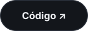</a>

<br />


</div>

<br />

<div align="center">

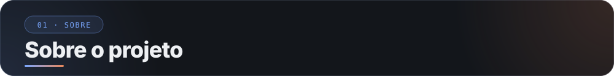

</div>

**Sua carteira de FIIs em papel e tijolo.**<br />
Acompanhe preço médio, proventos e meta de alocação, e simule novos aportes direto no navegador.

<br />

<div align="center">

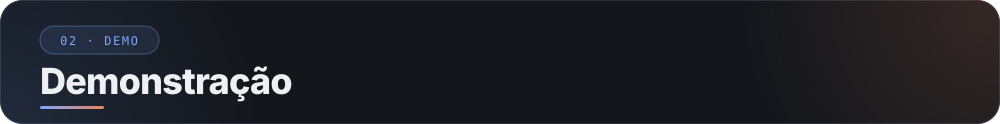

</div>

<div align="center">

<sub>Capturas com dados fictícios, só para demonstração.</sub>

<picture><source media="(prefers-color-scheme: dark)" srcset="docs/assets/shot-01.svg" />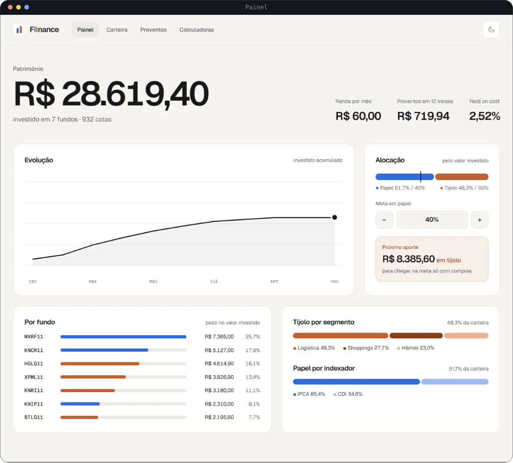</picture>

<br />

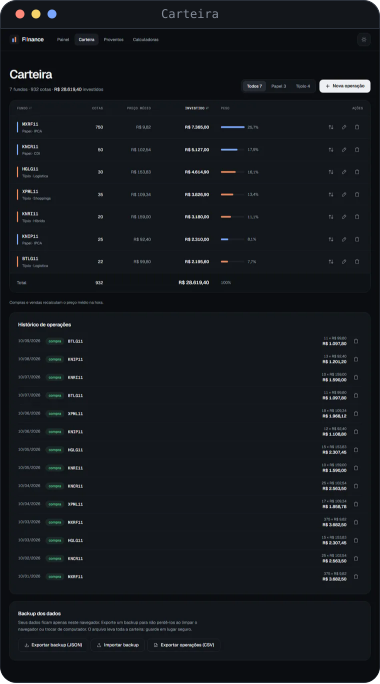
<br />
<sub><b>Carteira</b>: posição, preço médio e peso de cada fundo.</sub>

<br />

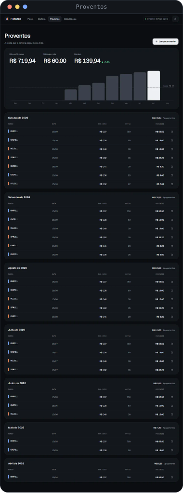
<br />
<sub><b>Proventos</b>: renda mensal e histórico de pagamentos.</sub>

<br />

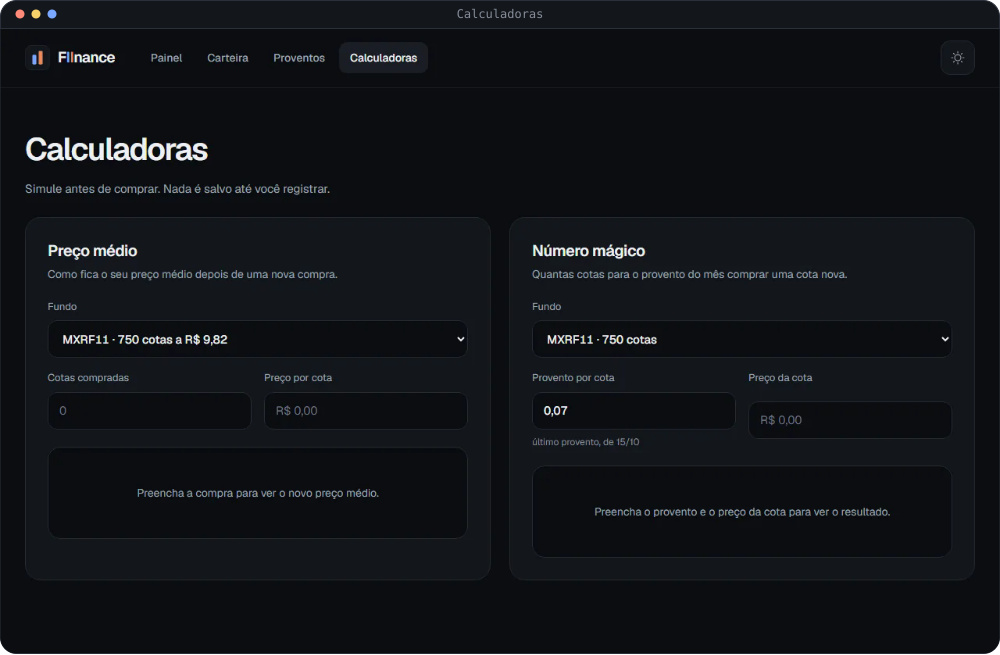
<br />
<sub><b>Calculadoras</b>: novo preço médio e número mágico.</sub>

<br />

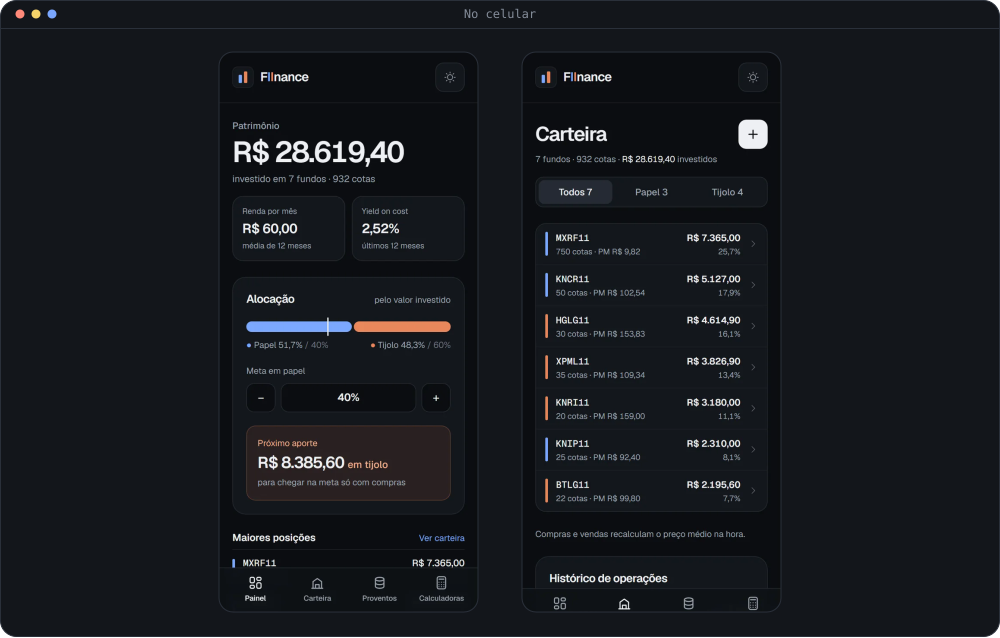
<br />
<sub><b>No celular</b>: o layout se adapta à tela.</sub>

</div>

<br />

<div align="center">

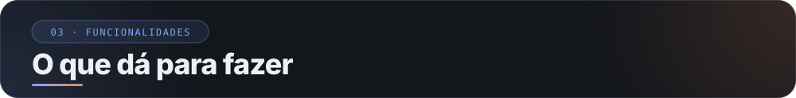

</div>

<div align="center">

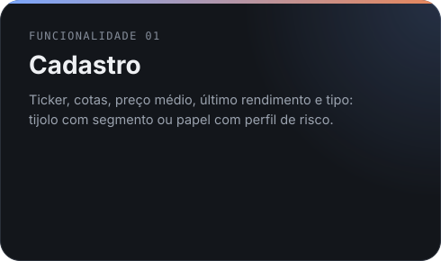
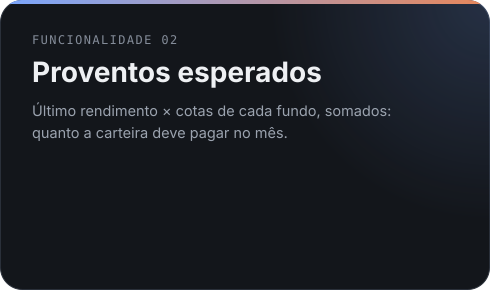
<br />
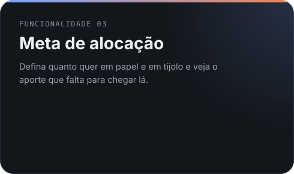
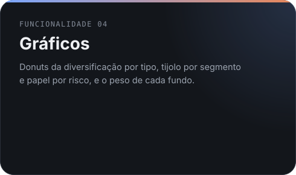
<br />
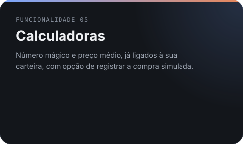
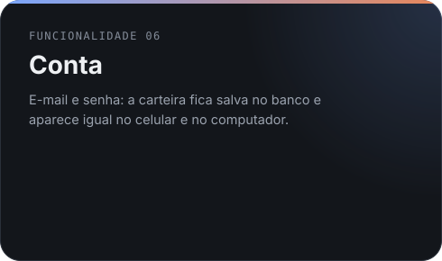
<br />
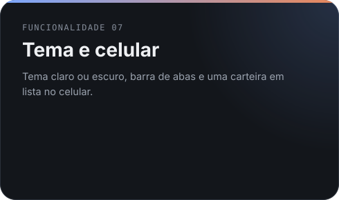

</div>

<br />

<div align="center">

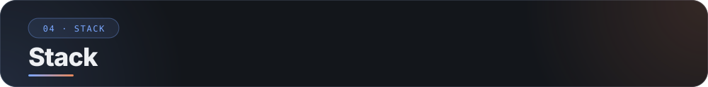

</div>

<div align="center">

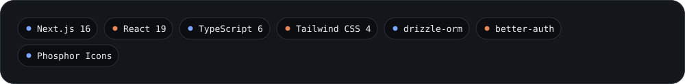

</div>

<br />

<div align="center">

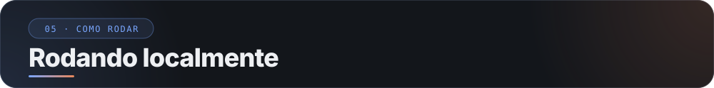

</div>

Requer [Node.js](https://nodejs.org) e [pnpm](https://pnpm.io).

```bash
git clone https://github.com/diegonatalo/fiinance.git
cd fiinance
pnpm install
pnpm dev        # http://localhost:3000
```

| Comando | O que faz |
|---|---|
| `pnpm dev` | Servidor de desenvolvimento, também acessível pela rede local |
| `pnpm build` | Checa os tipos e gera o build de produção em `.next/` |
| `pnpm start` | Serve o build de produção |
| `pnpm lint` | Roda o ESLint |
| `pnpm test:e2e` | Roda os testes de ponta a ponta (Playwright) |

### 🔑 Variáveis de ambiente

Há uma só, e é opcional. O modelo está em [`.env.example`](.env.example).

| Variável | Descrição | Se não for definida |
|---|---|---|
| `NEXT_PUBLIC_SITE_URL` | URL pública do site, sem barra final. | Usa `https://fiinance1.vercel.app` (valor padrão em `lib/site.ts`). |

### 🧪 Testes

```bash
pnpm test
```

Usa [Vitest](https://vitest.dev). Os testes cobrem os cálculos da carteira (preço médio, número mágico, alocação, sugestão de aporte, proventos), a validação e a exportação dos dados, a formatação de números e datas e a geometria dos gráficos.

Para reexecutar ao salvar: `pnpm test:watch`.

Os testes de ponta a ponta (Playwright, em `e2e/`) abrem o app no Chromium e percorrem os fluxos inteiros: adicionar um FII e recarregar, somar uma segunda compra, ver o total no painel, ajustar a meta de alocação, exportar e importar o backup, e abrir todas as páginas sem erros.

```bash
pnpm exec playwright install chromium   # só na primeira vez
pnpm test:e2e                           # gera o build e testa contra ele
```

Os prints da landing (`public/landing/`) e do README (`docs/screenshots/`) também saem do Playwright, com uma carteira de exemplo:

```bash
SCREENSHOTS=1 pnpm test:e2e e2e/screenshots.spec.ts
```

<br />

<div align="center">

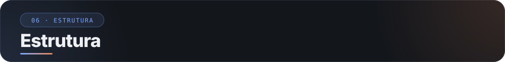

</div>

```text
├── app/          rotas do Next (App Router): landing (/), app (/app/...), /privacidade, /termos, 404, robots e sitemap;
│                 o corpo de cada tela fica em components/ (portfolio-page.tsx…)
├── types/        tipos do domínio: Asset, Transaction, Payout, AppData
├── lib/          lógica pura: posição, resumo, proventos, metas,
│                 calculadoras, gráficos, validação dos dados, exportação
├── hooks/        use-portfolio (estado e ações), use-local-storage, use-theme
├── e2e/          testes de ponta a ponta (Playwright)
└── components/   interface (ui/: Button, Card, Modal, Field, Input), marca, providers
```

> [!NOTE]
> A lógica de negócio fica em `lib/`, em funções puras sem dependência de React. Os componentes só chamam essas funções.

<br />

<div align="center">

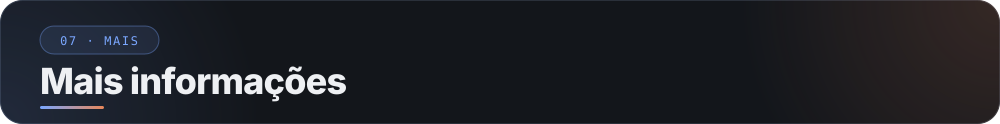

</div>

### 🧩 Como adicionar uma página nova

1. Crie `app/nome/nome-page.tsx` exportando o componente da tela (com `"use client"` no topo).
2. Crie `app/nome/page.tsx`, importando e renderizando esse componente.
3. Inclua o item em `navItems`, no `components/app-shell.tsx`, para aparecer no menu.
4. Adicione o caminho em `ROUTES`, no `lib/site.ts`, para entrar no `sitemap.xml`.

### 🔒 Seus dados

Não há servidor nem conta. Tudo é salvo no `localStorage` do navegador, na chave `fiinance:data:v1`.

Limpar os dados do navegador apaga a carteira, então use **Carteira → Backup dos dados** de vez em quando.
Ao importar, o app confere se o arquivo é um backup do fiinance e se cada registro está certo; se não estiver, recusa e nada muda.

O app não busca cotações: os valores são sempre o que você investiu, a partir das compras e vendas que você lança.

### 🧠 Como funciona

O app guarda **operações**, e a posição de cada fundo é sempre derivada delas.

| Conceito | Regra |
|---|---|
| **Compra** | Soma as cotas e recalcula o preço médio ponderado. |
| **Venda** | Reduz as cotas e mantém o preço médio. Não deixa vender mais do que havia na data. |
| **Provento** | `valor por cota × cotas em carteira na data do pagamento`. |
| **Yield on cost (12m)** | Proventos dos últimos 12 meses ÷ total investido. |
| **Número mágico** | `⌈preço da cota ÷ provento por cota⌉`: cotas para o provento do mês comprar uma nova. |
| **Peso** | Fatia de cada fundo no total investido. O app não busca cotações. |
| **Aporte para a meta** | Menor compra em uma só classe que leva à proporção desejada: `(A + x) / (T + x) = alvo`. |

> Os valores servem para acompanhamento e não substituem a nota de corretagem nem o informe de
> rendimentos. O app não calcula imposto de renda.

### 🌐 Deploy

O app é publicado na [Vercel](https://vercel.com). A Vercel detecta o Next.js, então não há configuração extra. A landing fica em `/` e o app em `/app` (`/app/carteira`, `/app/proventos`, `/app/calculadoras`); os endereços antigos sem `/app` redirecionam com 308 (`lib/redirects.ts`). Atualizar a página em `/app/carteira`
funciona, e um endereço inexistente devolve a 404 do próprio app, com status 404.

Ao mudar de domínio, defina `NEXT_PUBLIC_SITE_URL` no build (ou altere o valor padrão em `lib/site.ts`). É ela que gera o `sitemap.xml`,
o `robots.txt` e as URLs absolutas de `og:image` e `twitter:image` usadas nos previews de links.

### 🧭 Próximos passos

- [ ] CI rodando lint, tipos e testes a cada push.
- [ ] Lucro realizado e imposto de renda sobre vendas.
- [ ] Paginação do histórico de operações e de proventos, que cresce com o tempo.
- [ ] Sincronização entre dispositivos. Hoje o caminho é o backup em JSON.

### 📄 Créditos e licença

- Ícones do [Phosphor Icons](https://phosphoricons.com) e fontes [Geist](https://vercel.com/font).
- Distribuído sob a licença **MIT**. Veja o arquivo [LICENSE](LICENSE).

<br />

<div align="center">

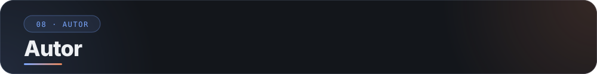

</div>

<div align="center">

<a href="https://diegonatalo.dev">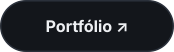</a>
<a href="https://www.linkedin.com/in/diegonatalo/">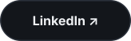</a>
<a href="https://github.com/diegonatalo">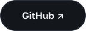</a>

</div>

<br />

<div align="center">

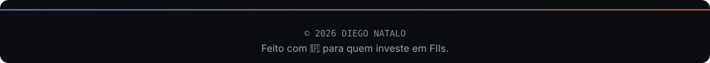

</div>
